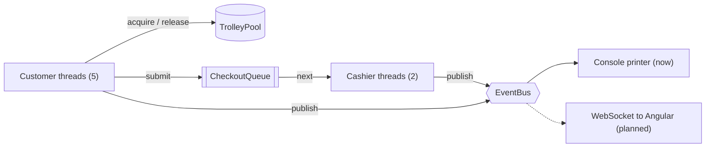
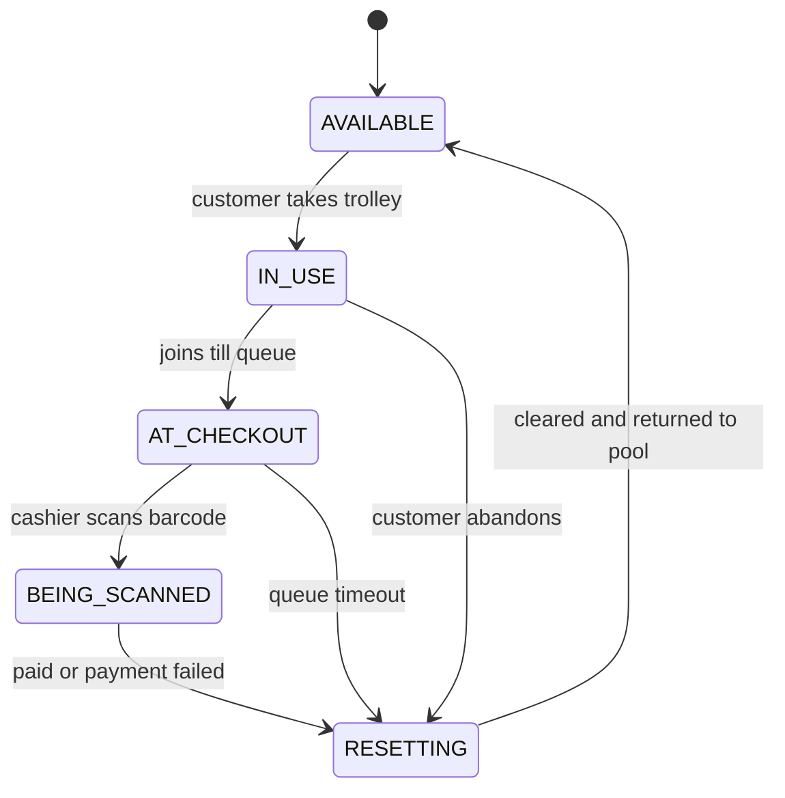

# Virtual Trolley

A multithreaded simulation of a **smart-trolley supermarket**. Customers shop with trolleys that total price and weight automatically, then walk to the till, where a cashier scans the trolley barcode and the whole basket appears on screen. No unpacking, no item-by-item scanning.

Built in Java with a focus on **correct concurrency**: a blocking trolley pool, a producer-consumer checkout line, lock-free stock control and batch scheduling.

> **Status:** Week 1-2 complete (domain model + console simulation, 19 passing tests).
> Next: Spring Boot + WebSocket event stream, then an Angular dashboard with a live top-down shop view.

---

## The idea

1. A customer takes a trolley at the entrance. It is **locked** to them until checkout is finished.
2. As they shop, every item added updates the trolley's **running total price and weight**. Putting an item back subtracts exactly one unit price.
3. At the till, the cashier **scans the trolley barcode**. The basket, total and weight appear instantly.
4. The customer pays, a receipt prints, and the trolley **resets and returns to the pool**.

### Constraints modelled

| Rule | Implementation |
|---|---|
| 5 customers at a time | Fixed thread pool sized to the batch |
| 5 trolleys | `TrolleyPool` (blocking queue) |
| 2 cashiers | Fixed thread pool consuming the checkout queue |
| Customers arrive in batches of 5 | `invokeAll()` acts as the batch barrier |
| Trolley locked once taken | Removed from the pool and owner-checked on every change |

---

## Architecture



The simulation never talks to a UI directly. It publishes immutable events and anything interested subscribes. That keeps the core testable without a window and makes the later web dashboard a drop-in subscriber.

### Trolley lifecycle



Illegal transitions throw immediately. For example, scanning a trolley that is still being shopped with is rejected.

### Package layout

```
com.virtualtrolley
├── domain/model     Product, CartLine, CartSnapshot, Receipt, Trolley, TrolleyState
├── store            ProductCatalog, Inventory, StockEntry
├── events           EventBus, EventType, SimulationEvent, ConsoleEventPrinter
├── payment          PaymentStrategy, CardPayment, PaymentResult
├── config / stats / util
└── simulation
    ├── pool         TrolleyPool
    ├── customer     CustomerTask, ShoppingStrategy, RandomShopper
    ├── cashier      CashierTask, CheckoutQueue, CheckoutRequest
    └── batch        BatchController
```

`domain` has no knowledge of the threads that use it. Dependencies point inward only.

---

## Design patterns used

| Pattern | Where | Why |
|---|---|---|
| **Object Pool** | `TrolleyPool` | Fixed set of trolleys, no double-booking |
| **Producer-Consumer** | `CheckoutQueue` | Customers and cashiers work at different speeds |
| **State** | `TrolleyState` | One source of truth for legal transitions |
| **Observer / Event Bus** | `EventBus` | Decouples simulation from presentation |
| **Strategy** | `PaymentStrategy`, `ShoppingStrategy` | Swap payment methods and shopper behaviour |
| **Memento (snapshot)** | `CartSnapshot` | Cashier sees a frozen, immutable copy of the basket |
| **Poison Pill** | `CheckoutRequest.POISON_PILL` | Clean cashier shutdown |
| **Lease** | `CustomerTask` `finally` block | A trolley always returns, even if the customer fails |

---

## Concurrency decisions

- **Trolley ownership:** a pooled trolley is invisible to other threads, and `Trolley` rejects changes from anyone but its owner.
- **Stock control is lock-free.** `Inventory.tryTake` uses a compare-and-set loop on an `AtomicInteger`, so two customers can never take the last unit. A test with 50 racing threads proves exactly one wins.
- **The trolley is leased.** Whatever happens after a customer takes a trolley, a `finally` block resets it and returns it to the pool. Unpaid goods go back on the shelves, so stock is never lost on a failed payment.
- **Bounded waiting.** Customers wait at the till with a timeout, so a stuck cashier cannot hang the run.
- **Failure isolation.** A cashier that hits an error completes the customer's future exceptionally and carries on. A crashing customer is counted as abandoned instead of killing the run.
- **Clean shutdown.** Poison pills stop the cashier threads, and both pools are shut down in a `finally` block.
- **Money is `long` cents and weight is `long` grams.** No floating-point arithmetic touches prices.
- **No locks are held while publishing events.**
- **Named threads** (`customer-thread-1`, `cashier-thread-2`) keep thread dumps readable.

---

## Getting started

### Prerequisites

- JDK 21 or newer
- Maven 3.9+

### Run the tests

```bash
mvn test
```

### Run the simulation

```bash
mvn compile
java -cp target/classes com.virtualtrolley.ConsoleSimulationApp
```

In IntelliJ, open `ConsoleSimulationApp` and click the green arrow beside `main`.

### Sample output

```
[   101 ms] system       === Batch 1: 5 customers enter ===
[   109 ms] customer-2   Took trolley #2 (TRL-0002), now locked
[   128 ms] customer-3   + Maize Meal 10kg           R99.99 | trolley R99.99, 10.0 kg
[  1035 ms] customer-4   - Eggs 30s                  R69.99 | trolley R359.96, 23.1 kg
[  1070 ms] cashier-2    Scanned TRL-0005 (customer-5) | 5 items | R509.95 | 22.4 kg
     1 x Coffee 750g               R159.99
     2 x Cooking Oil 5L            R169.98
     2 x Full Cream Milk 6x1L      R179.98
[  1800 ms] cashier-2    RECEIPT #00002 | customer-5 | CARD
    TOTAL R509.95
[  1800 ms] customer-5   Trolley #5 reset and returned
[  3731 ms] customer-9   Sold out: Rice 10kg
...
---------------- SUMMARY ----------------
Customers: 10 (paid 10, payment failed 0, abandoned 0)
Revenue:   R4,471.57
Trolleys back in pool: 5/5
```

### Configuration

Everything tunable lives in `SimulationConfig`:

| Setting | Default | Meaning |
|---|---|---|
| `seed` | 42 | Seeds shopping lists, so runs are reproducible |
| `totalCustomers` | 10 | Customers across all batches |
| `batchSize` | 5 | Customers shopping at once |
| `trolleyCount` | 5 | Trolleys in the pool |
| `cashierCount` | 2 | Tills open |
| `minItems` / `maxItems` | 3 / 6 | Items per shopping trip |
| `maxShopDelayMs` / `maxCashierDelayMs` | 400 / 900 | Upper bounds for simulated walking and till time |
| `paymentFailureRate` | 0.10 | Share of card payments declined |
| `checkoutTimeoutMs` | 30000 | How long a customer waits at the till |

Set both delays to 0 (`withoutDelays()`) for instant runs in tests. Setting `paymentFailureRate` to `1.0` exercises the failure path.

---

## Tests

19 tests, all passing.

| Suite | Tests | Covers |
|---|---|---|
| `TrolleyTest` | 8 | Price and weight totals, owner enforcement, state transitions, snapshot immutability |
| `InventoryTest` | 4 | 50-thread race for the last item, stock never negative, restock |
| `TrolleyPoolTest` | 3 | Trolley locks to owner, a sixth customer blocks until release, release resets |
| `SimulationRunTest` | 4 | Every customer accounted for, all trolleys return, revenue matches sales, declined payments restore stock |

End-to-end tests carry a timeout, so a deadlock fails the build instead of hanging it.

---

## Roadmap

- [x] Domain model and trolley state machine
- [x] Concurrent console simulation with batches
- [x] Unit and concurrency tests
- [ ] Statistics: average queue wait, cashier utilisation, batch duration
- [ ] Spring Boot wrapper with REST controls (`start`, `pause`, `reset`)
- [ ] WebSocket (STOMP) event stream
- [ ] Angular dashboard: live canvas shop map, cashier screen, stats panel
- [ ] Pricing decorators (discounts, weighed produce)
- [ ] Hardware ports: `TrolleySensor` adapter for scale and barcode

---

## Tech stack

Java 21, Maven, JUnit 5. Planned: Spring Boot, WebSocket/STOMP, Angular, RxJS, HTML canvas.

## Author

**Your Name** · [GitHub](https://github.com/YOUR-USERNAME) · [LinkedIn](https://www.linkedin.com/in/YOUR-PROFILE)
