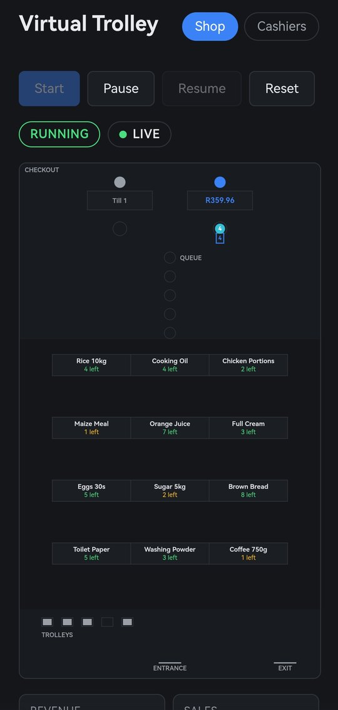
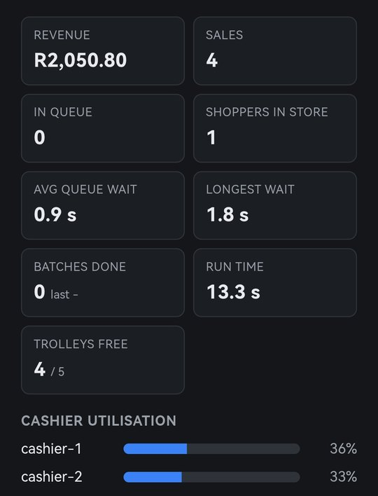
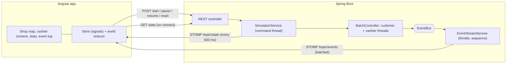
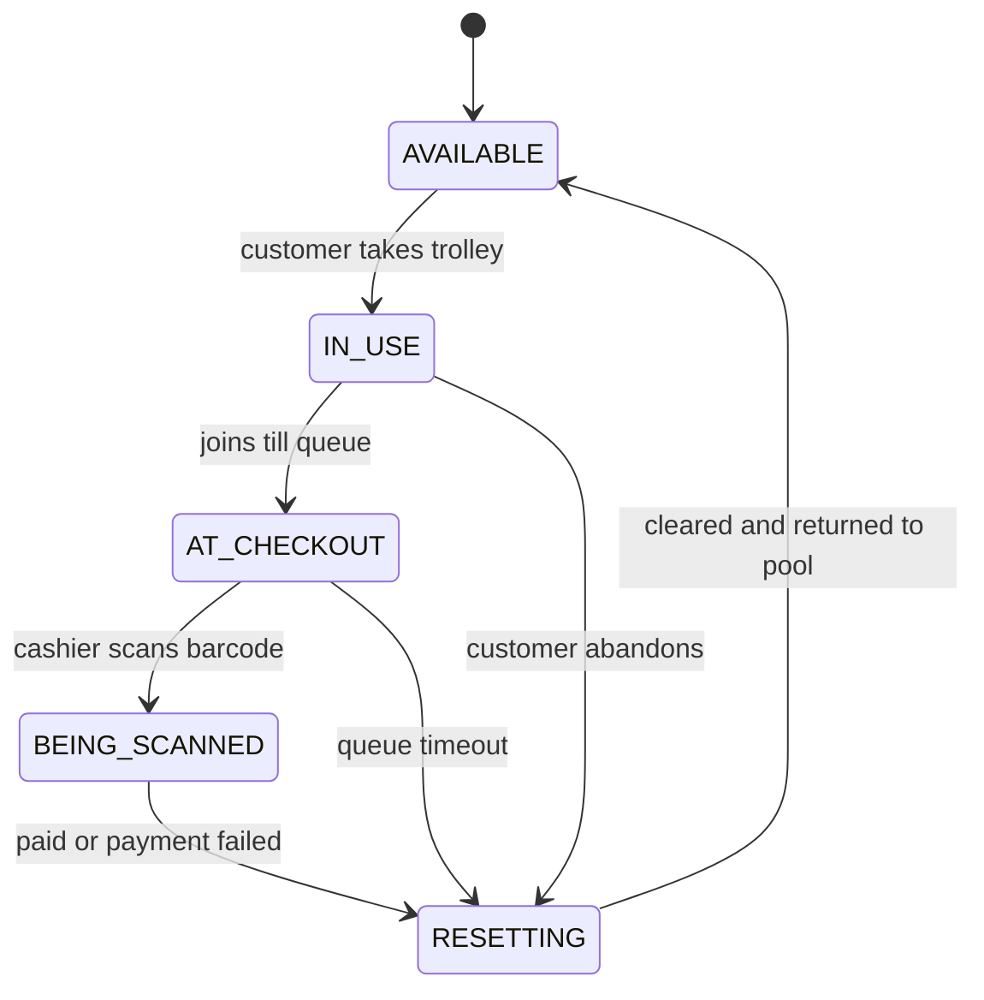

# Virtual Trolley


A real-time simulation of a **smart-trolley supermarket**. Customers shop with trolleys that total price and weight automatically, then walk to the till, where a cashier scans the trolley barcode and the whole basket appears on screen. No unpacking, no item-by-item scanning.

The backend is a multithreaded **Java / Spring Boot** simulation focused on correct concurrency. It streams every event over **WebSocket** to an **Angular** dashboard with a live top-down shop map, cashier screens and a stats panel.

## Screenshots

<table>
  <tr>
    <td align="center"><b>Live shop map</b></td>
    <td align="center"><b>Stats panel</b></td>
  </tr>
  <tr>
    <td></td>
    <td></td>
  </tr>
</table>

The map shows a customer being served at till 2 (the basket total appears on the counter screen), live stock on every shelf, and the trolley rack. Amber shelves are running low and red ones are sold out.

## Features

- **Live shop map:** a top-down canvas where customers walk the aisles, queue and check out. Shelf stock updates in real time.
- **Cashier screens:** the scanned basket appears at once, then the printed receipt. Declined payments show a reason.
- **Stats panel:** revenue, queue length, average and longest wait, batch times, trolleys free, and cashier utilisation.
- **Run controls:** start, pause, resume and reset, safe to use at any moment.
- **Refresh-proof:** reload the page mid-run and it catches up without gaps or duplicates.
- **Reproducible:** a seed fixes every shopping list; thread timing still varies like a real shop.

## The idea

1. A customer takes a trolley at the rack. It is **locked** to them until checkout is finished.
2. Every item added updates the trolley's **running total price and weight**. Putting an item back subtracts exactly one unit price.
3. At the till, the cashier **scans the trolley barcode** and the basket, total and weight appear instantly.
4. The customer pays, a receipt prints, and the trolley **resets and returns to the pool**.

| Rule | Implementation |
|---|---|
| 5 customers at a time | Fixed thread pool sized to the batch |
| 5 trolleys | `TrolleyPool` (blocking queue) |
| 2 cashiers | Fixed thread pool consuming the checkout queue |
| Customers arrive in batches of 5 | `invokeAll()` acts as the batch barrier |
| Trolley locked once taken | Removed from the pool; owner-checked on every change |

## Architecture



The simulation never talks to a UI directly. It publishes immutable events and anything interested subscribes, which keeps the core testable without a server and the web layer replaceable.

### Trolley lifecycle



Illegal transitions throw immediately; for example, scanning a trolley that is still being shopped with is rejected.

### Project layout

```
virtual-trolley/
├── pom.xml
├── src/main/java/com/virtualtrolley/
│   ├── domain/model     Product, Trolley, TrolleyState, CartSnapshot, Receipt
│   ├── store            ProductCatalog, Inventory
│   ├── events           EventBus, EventStreamService, SequencedEvent
│   ├── payment          PaymentStrategy, CardPayment
│   ├── stats / config / util
│   ├── api              REST controller, WebSocket config, STOMP senders
│   └── simulation
│       ├── pool         TrolleyPool
│       ├── customer     CustomerTask, ShoppingStrategy
│       ├── cashier      CashierTask, CheckoutQueue
│       ├── batch        BatchController
│       └── control      SimulationService, PauseGate, StatePublisher
└── frontend/src/app/
    ├── core             store, socket + API services, world reducer, scene, layout, drawing
    └── features         shop-map, cashier-screen, stats-panel, control-bar, event-log
```

`domain` has no knowledge of threads, Spring or the network. Dependencies point inward only.

## Design patterns

| Pattern | Where | Why |
|---|---|---|
| **Object Pool** | `TrolleyPool` | Fixed set of trolleys, no double-booking |
| **Producer-Consumer** | `CheckoutQueue` | Customers and cashiers work at different speeds |
| **State** | `TrolleyState` | One source of truth for legal transitions |
| **Observer / Event Bus** | `EventBus` | Decouples simulation from presentation |
| **Strategy** | `PaymentStrategy`, `ShoppingStrategy` | Swap payment methods and shopper behaviour |
| **Memento** | `CartSnapshot` | Cashier sees a frozen, immutable copy of the basket |
| **Command** | `SimulationService` | Start, pause and reset run on one thread, so button spam cannot interleave |
| **Ports and Adapters** | `EventSender`, `StateSender` | STOMP is one adapter; tests use a plain lambda |
| **Poison Pill** | `CheckoutRequest.POISON_PILL` | Clean cashier shutdown |
| **Lease** | `CustomerTask` `finally` block | A trolley always returns, even if the customer fails |
| **Reducer / Store** | `world.ts`, `SimulationStore` | Frontend state is a pure fold over the event stream |

## Concurrency decisions

- **Trolley ownership:** a pooled trolley is invisible to other threads, and `Trolley` rejects changes from anyone but its owner.
- **Lock-free stock:** `Inventory.tryTake` uses a compare-and-set loop. A test with 50 racing threads proves exactly one wins the last item.
- **Leased trolleys:** whatever happens after a customer takes a trolley, a `finally` block resets it and returns it to the pool. Unpaid goods go back on the shelves.
- **Cooperative pause:** workers park at a `PauseGate` between steps. In-flight work finishes first, and pause time is excluded from utilisation figures.
- **Cancellation:** reset interrupts the run. Every trolley is returned, even when the run was paused, verified by repeated cancel tests.
- **No stale events:** each run gets its own event bus, so a cancelled run cannot leak into the next one.
- **Throttled streaming:** events are sent as one batch every 50 ms instead of one message each, with sequence numbers for catch-up.
- **Bounded waiting and failure isolation:** a stuck till cannot hang a customer, and one crashing customer is counted as abandoned instead of killing the run.
- **Money is `long` cents and weight is `long` grams.** No floating-point arithmetic touches prices.

## Frontend highlights

- **Gap-free catch-up:** on every (re)connect the app loads a server snapshot, then applies streamed events, skipping any whose sequence number the snapshot already covers.
- **Pure world reducer:** `reduceWorld(world, event)` is immutable and tested on its own; the canvas animation is a separate layer on top.
- **Walking timed by the backend:** the server announces each walk and its duration, and the avatar arrives when the event says it does.
- **Shelf-safe routing:** customers use side corridors and walkways, and a test checks that no route between any two places crosses a shelf.
- **Zoneless, signal-driven Angular** with standalone components and OnPush throughout.
- **Responsive:** a portrait map that suits phones, with light and dark themes.

## Getting started

### Prerequisites

- JDK 21 or newer
- Maven 3.9+
- Node 20.19+, 22.12+ or 24+

### Run

```bash
# Terminal 1: backend (http://localhost:8080)
mvn spring-boot:run

# Terminal 2: frontend (http://localhost:4200)
cd frontend
npm install
npm start
```

| URL | What |
|---|---|
| `http://localhost:4200/` | Shop map, stats, controls and event log |
| `http://localhost:4200/cashier` | Cashier screens (open in a second tab) |
| `http://localhost:8080/monitor.html` | Minimal debug monitor served by the backend |

The Angular dev server proxies `/api` and `/ws` to the backend (`frontend/proxy.conf.json`).

### Headless console run

```bash
mvn compile
java -cp target/classes com.virtualtrolley.ConsoleSimulationApp
```

### Configuration

Set in `src/main/resources/application.yml` under `trolley.simulation`:

| Setting | Default | Meaning |
|---|---|---|
| `seed` | 42 | Seeds shopping lists, so runs are reproducible |
| `total-customers` | 10 | Customers across all batches |
| `batch-size` | 5 | Customers shopping at once |
| `trolley-count` | 5 | Trolleys in the pool |
| `cashier-count` | 2 | Tills open |
| `min-items` / `max-items` | 3 / 6 | Items per shopping trip |
| `max-shop-delay-ms` / `max-cashier-delay-ms` | 2500 / 3500 | Upper bounds for walking and till time; lower for a faster run |
| `payment-failure-rate` | 0.10 | Share of card payments declined |
| `checkout-timeout-ms` | 600000 | How long a customer waits at the till |

Restart the backend after changing them.

## API

| Endpoint | Purpose |
|---|---|
| `POST /api/simulation/start` | Start a run |
| `POST /api/simulation/pause` / `resume` | Pause or resume at the next step boundary |
| `POST /api/simulation/reset` | Cancel the run and clear everything |
| `GET /api/simulation/state` | Snapshot: status, trolleys, stock, stats, recent events |
| `GET /api/products` | The catalogue with opening stock |

A command that is not valid in the current state returns **409** with `{"error": "..."}`.

**WebSocket** (STOMP over a plain socket at `ws://localhost:8080/ws`):

| Topic | Payload |
|---|---|
| `/topic/events` | A batch (array) of events, each with `seq`, `type`, `actor`, `message`, `at` and structured `data` |
| `/topic/state` | The current snapshot, every 500 ms and on every status change |

## Testing

```bash
mvn test                                   # backend
cd frontend && npm test -- --watch=false   # frontend
```

| Area | Tests | Covers |
|---|---|---|
| Backend | 53 | Trolley rules and lifecycle, 50-thread stock race, pool blocking, pause and cancel (including while paused), event contract, stats, state publishing, REST lifecycle and 409 conflicts |
| Frontend | 96 | Store and snapshot merging, world reducer, route-finding, scene animation, drawing, cashier screens, stats panel |

Concurrency tests carry timeouts, so a deadlock fails the build instead of hanging it. GitHub Actions runs the backend on JDK 21 and 25, and the frontend tests and production build, on every push.

## Roadmap

- [x] Domain model and trolley state machine
- [x] Concurrent console simulation with batches
- [x] Spring Boot API with pause, resume and reset
- [x] WebSocket event stream
- [x] Angular app with live event log
- [x] Canvas shop map, cashier screens, stats panel
- [x] CI for backend and frontend
- [x] Screenshots
- [ ] Demo GIF
- [ ] Speed control (1x, 2x, 5x) on the dashboard
- [ ] Pricing decorators (discounts, weighed produce)
- [ ] `TrolleySensor` adapter for scale and barcode hardware

## Tech stack

Java 21, Spring Boot 3, WebSocket/STOMP, Maven, JUnit 5 · Angular 21, RxJS, signals, HTML canvas, Vitest · GitHub Actions

## Author

**Owen Vurayai** · [GitHub](https://github.com/Owenvurayai) · [LinkedIn](https://www.linkedin.com/in/https://www.linkedin.com/in/owen-vurayai-a71922266?)
